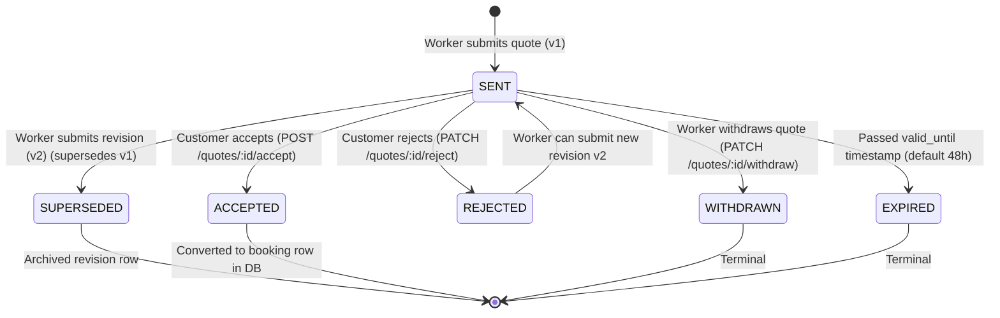

# TaskLync Custom Service Request & Dynamic Quote System
## Customer Mobile App Architectural Audit & End-to-End Implementation Plan

> **Classification:** Engineering Architecture & Production Implementation Blueprint  
> **Target Application:** TaskLync Customer Mobile App (`tasklync-customer-app`)  
> **Framework:** React Native (0.86.3) / Expo SDK 57 (expo-router ~57.0.17) / TypeScript 6.0  
> **Target Backend:** TaskLync Microservices Monorepo (`tasklync-backend`)  
> **Counterparty Application:** TaskLync Worker Mobile App (`tasklync-worker-app`)  
> **Author:** Principal Mobile App Engineer, Senior UI/UX Architect & Backend Integration Specialist  
> **Engineering Standards:** Uber, Careem, Foodpanda, Zomato, Swiggy  
> **Status:** READY FOR IMPLEMENTATION (Audit & Planning Only — No Application Code Modified)  
> **Deliverable File:** `docs/custom-service-quote-customer-app-implementation-plan.md`  
> **Date:** October 2026  

---

## 1. Executive Summary

### 1.1 Business Context & Problem Statement
TaskLync operates an on-demand home services marketplace across major urban centers in Pakistan (starting in Faisalabad and expanding across Punjab). The platform currently features a standardized **fixed-price catalog booking flow**: a customer browses fixed service items (e.g., *Ceiling Fan Installation — PKR 800*), adds services to a persistent cart, selects a calendar date and 30-minute time slot, selects a verified delivery address within the geofenced service area, reviews estimated pricing, and confirms the booking via Cash on Delivery (COD).

However, over 60% of high-value home service requests in Pakistan (especially electrical troubleshooting, plumbing leakages, HVAC diagnostics, water seepage, carpentry alterations, and masonry repair) cannot be categorized into fixed unit prices a priori. Customers require a **Custom Service Request & Dynamic Quote (RFQ)** system:
1. Customers submit an unstructured diagnostic/repair request with problem description, photos/video, service location, and preferred scheduling window directly to a target verified professional.
2. The professional reviews the job site details and media, optionally asks clarifying questions via real-time messaging, and issues a formal binding **Quote** or preliminary **Estimate** specifying work labor charges, optional inspection fee, work scope, duration, and validity window.
3. The customer reviews the transparent price breakdown (including server-computed platform fees) and, upon acceptance, enters the **authoritative TaskLync checkout pipeline** to select/reconfirm scheduling, confirm the delivery address, and confirm Cash on Delivery.
4. Only upon successful completion of the full checkout gate (including Redis distributed lock acquisition and PostgreSQL schedule conflict checks) does a formal **confirmed booking** (`status: 'ACCEPTED'`) materialize.

### 1.2 System Audit & Readiness Scorecard
Thorough inspection of all three repositories (`tasklync-backend`, `tasklync-worker-app`, and `tasklync-customer-app`) reveals the exact readiness status:

| Component | Repository / Domain | Audit Status | Implementation State | Evidence / References |
| :--- | :--- | :--- | :--- | :--- |
| **Backend DDL & Migrations** | `booking-service` | **Verified** | **100% Implemented** | `migrations/009_create_custom_requests_and_quotes.sql` |
| **Backend Request Engine** | `booking-service` | **Verified** | **100% Implemented** | `custom-request.controller.ts`, `custom-request.service.ts`, `custom-request.repository.ts` |
| **Backend Quote Engine** | `booking-service` | **Verified** | **100% Implemented** | `quote.controller.ts`, `quote.service.ts`, `quote.repository.ts` |
| **Backend Dynamic Checkout** | `booking-service` | **Verified** | **100% Implemented** | `POST /api/v1/bookings/from-quote` in `booking.service.ts` |
| **Backend API Gateway Proxy** | `api-gateway` | **Verified** | **100% Implemented** | `routes.config.ts` routing `/custom-requests` and `/quotes` to `booking-service` |
| **Backend Pre-Booking Chat** | `chat-service` | **Verified** | **100% Implemented** | `POST /api/v1/chat/rooms/request/:requestId` in `chat.routes.ts` & `room.service.ts` |
| **Backend Event Dispatch & Push** | `notification-service` | **Verified** | **100% Implemented** | Kafka consumer in `booking-events.consumer.ts`, 5 push templates in `templates/push/` |
| **Worker App APIs & Hooks** | `tasklync-worker-app` | **Verified** | **100% Implemented** | `customRequest.api.ts`, `useCustomRequestDetail.ts`, `useQuoteSubmit.ts` |
| **Worker App Screens & UI** | `tasklync-worker-app` | **Verified** | **100% Implemented** | `app/custom-request/[id]/index.tsx`, `create-quote.tsx`, `quote-details.tsx` |
| **Worker App Real-time & Links**| `tasklync-worker-app` | **Verified** | **100% Implemented** | `deepLink.service.ts` resolving `tasklync://custom-requests/*`, `chat/request/[requestId].tsx` |
| **Customer App APIs & Client** | `tasklync-customer-app` | **Audited** | **Missing** | No custom request or quote endpoints in `src/services/api/` |
| **Customer App Screens & UI** | `tasklync-customer-app` | **Audited** | **Missing** | No request submission wizard, request detail screen, or quote review screen |
| **Customer App Deep Linking** | `tasklync-customer-app` | **Audited** | **Partially Implemented** | `src/utils/deepLink.ts` handles bookings/chat, but drops `tasklync://custom-requests/*` and `tasklync://quotes/*` to `/notifications` fallback |
| **Customer App Quote Checkout** | `tasklync-customer-app` | **Audited** | **Missing** | Existing checkout tightly coupled to `useCartStore` items; no quote checkout flow |
| **Customer App Bookings Tab** | `tasklync-customer-app` | **Audited** | **Partially Implemented** | `(tabs)/bookings.tsx` only lists confirmed bookings; no tracking for open custom requests |

---

## 2. Verified Backend Architecture & State Machine

### 2.1 Microservices Topology & Boundary Matrix
The backend operates as an event-driven microservices architecture communicating via REST over an internal reverse proxy API Gateway, PostgreSQL shared database with schema isolation, Redis 7 for distributed locking and caching, and Apache Kafka for outbox event streaming.

```
┌─────────────────────────────────────────────────────────────────────────────────────────┐
│                                   API Gateway (:3000)                                   │
│  - JWT Bearer Authentication (RS256)                                                    │
│  - Injects headers: x-user-id, x-user-role, x-internal-key                              │
└────────┬─────────────────────────┬──────────────────────────────┬───────────────────────┘
         │ /api/v1/custom-requests │ /api/v1/chat                 │ /api/v1/notifications
         │ /api/v1/quotes          │ /api/v1/chat/rooms/request/* │ /api/v1/users/me/addresses
         │ /api/v1/bookings        │                              │
         ▼                         ▼                              ▼
┌─────────────────────────┐ ┌───────────────────────────┐ ┌──────────────────────────────┐
│  booking-service (:3004)│ │    chat-service (:3006)   │ │  user / notification-service │
│ - custom_service_request│ │ - chat_rooms              │ │ - users, user_addresses      │
│ - quotes                │ │ - messages                │ │ - FCM push notification bus  │
│ - quote_revisions       │ │ - Socket.IO WS server     │ │ - Kafka booking.events       │
│ - bookings              │ │   (/chat namespace)       │ │   consumer                   │
│ - outbox_events         │ └─────────────┬─────────────┘ └──────────────┬───────────────┘
└────────────┬────────────┘               │                              │
             │ Kafka 'booking.events'     │ Redis Pub/Sub                │
             └────────────────────────────┴──────────────────────────────┘
```

### 2.2 Complete Authoritative State Machine

#### Custom Service Request Lifecycle (`custom_request_status`)

```mermaid
stateDiagram-v2
    [*] --> SUBMITTED : Customer submits request (POST /custom-requests)
    SUBMITTED --> UNDER_REVIEW : Worker inspects request (PATCH /review)
    SUBMITTED --> DECLINED : Worker declines (PATCH /decline)
    SUBMITTED --> CANCELLED : Customer cancels (PATCH /cancel)
    SUBMITTED --> EXPIRED : 72 hours inactivity TTL
    
    UNDER_REVIEW --> CLARIFICATION_REQUESTED : Chat room opened (POST /chat/rooms/request/:id)
    UNDER_REVIEW --> QUOTE_SENT : Worker issues quote (POST /custom-requests/:id/quotes)
    UNDER_REVIEW --> DECLINED : Worker declines with reason
    UNDER_REVIEW --> CANCELLED : Customer cancels
    
    CLARIFICATION_REQUESTED --> QUOTE_SENT : Worker issues quote
    CLARIFICATION_REQUESTED --> DECLINED : Worker declines
    CLARIFICATION_REQUESTED --> CANCELLED : Customer cancels
    
    QUOTE_SENT --> ACCEPTED : Customer accepts quote (POST /quotes/:id/accept)
    QUOTE_SENT --> QUOTE_SENT : Worker revises quote (POST /revise, old becomes SUPERSEDED)
    QUOTE_SENT --> CANCELLED : Customer cancels request
    QUOTE_SENT --> DECLINED : Worker withdraws quote & declines request
    
    ACCEPTED --> CONVERTED : Customer completes checkout (POST /bookings/from-quote)
    CONVERTED --> [*] : Active Booking Lifecycle takes over
    
    DECLINED --> [*] : Terminal
    CANCELLED --> [*] : Terminal
    EXPIRED --> [*] : Terminal
```


#### Worker Quote Lifecycle (`quote_status`)


### 2.3 Verified Invariant Truths Established from Source Code
1. **Pre-Booking Decoupling Invariant:** Submitting a custom service request or issuing a quote is strictly pre-transactional. Neither action touches `worker_service.booked_slots`, blocks worker calendar availability, or creates a `bookings` record until checkout succeeds.
2. **Double-Acceptance Concurrency Protection:** Inside [`quote.service.ts`](file:///D:/tasklync-backend/tasklync-backend/services/booking-service/src/services/quote.service.ts#L185), quote acceptance executes `SELECT * FROM quotes WHERE id = $1 FOR UPDATE`. If a customer double-taps "Accept", the second transaction encounters `status === 'ACCEPTED'` and is immediately rejected with HTTP 409 `ALREADY_ACCEPTED`.
3. **Double-Checkout Concurrency Protection:** In [`booking.service.ts:createBookingFromQuote`](file:///D:/tasklync-backend/tasklync-backend/services/booking-service/src/services/booking.service.ts#L1120-L1130), the method checks `if (q.booking_id) throw new AppError('A booking has already been created from this quote', 409, 'BOOKING_ALREADY_CREATED')`.
4. **Calendar Slot Hold & Advisory Lock:** During `POST /api/v1/bookings/from-quote`, `booking-service` acquires:
   - Redis multi-slot distributed lock (`booking:slot:${workerId}:${dateStr}:${timeStr}`) with 5000ms TTL.
   - Worker schedule availability assertion (`assertWorkerAvailable(workerId)`).
   - Conflict check (`conflict.hasBookingConflict`).
   - PostgreSQL transaction-level advisory lock (`SELECT pg_advisory_xact_lock(hashtext('booking:provider:' || workerId))`).
5. **Immediate Direct Acceptance:** When a booking is created from an accepted quote, its status is set directly to `ACCEPTED` (not `PENDING`), because both parties have already explicitly agreed upon scope, time, and pricing.
6. **Automatic COD Ledger Provisioning:** `POST /api/v1/bookings/from-quote` atomically inserts a pending Cash on Delivery record into the `payments` table (`method = 'CASH_ON_DELIVERY'`, `status = 'PENDING'`) and returns instructions to pay cash upon completion.
7. **Strict Anti-IDOR Authorization:**
   - Worker endpoints verify: `request.worker_id === authUser.id`. Non-matching IDs receive HTTP 403 `FORBIDDEN_CUSTOM_REQUEST`.
   - Customer endpoints verify: `request.user_id === authUser.id`. Non-matching IDs receive HTTP 403 `FORBIDDEN_CUSTOM_REQUEST`.
8. **Deterministic Platform Fee Mathematics:**
   - Subtotal = $\text{work\_price} + \text{inspection\_fee}$.
   - Customer Platform Fee = $5\%$ of Subtotal (rounded to 2 decimal places).
   - Total Price (Customer Payable) = $\text{subtotal} + \text{customer\_platform\_fee}$.
   - Worker Commission = $5\%$ of Subtotal.
   - Net Worker Earnings = $\text{subtotal} - \text{worker\_commission}$.

---

## 3. Backend Audit Findings with Exact File References

### 3.1 REST API Endpoints Specification

#### 1. `POST /api/v1/custom-requests`
- **Location:** [`custom-request.controller.ts:create`](file:///D:/tasklync-backend/tasklync-backend/services/booking-service/src/controllers/custom-request.controller.ts#L15-L35), [`custom-request.validators.ts:createCustomRequestSchema`](file:///D:/tasklync-backend/tasklync-backend/services/booking-service/src/validators/custom-request.validators.ts#L4-L23)
- **Role Required:** `user` (Customer JWT)
- **Request Headers:** `Authorization: Bearer <token>`, `Content-Type: application/json`
- **Request Payload:**
```json
{
  "worker_id": "9b1deb4d-3b7d-4bad-9bdd-2b0d7b3dcb6d",
  "category_id": "electrician",
  "title": "Main circuit breaker tripping intermittently",
  "description": "Every time the AC turns on, the main DB breaker trips. Need full electrical panel inspection and repair.",
  "address_id": "4a7b5d2e-1c3f-4e5a-8b9d-0f1e2d3c4b5a",
  "address_text": "House 42, Street 5, Gulberg III, Lahore",
  "latitude": 31.5204,
  "longitude": 74.3587,
  "preferred_date": "2026-10-25",
  "preferred_time_slot": "10:00-12:00",
  "media": [
    {
      "media_type": "IMAGE",
      "media_url": "https://res.cloudinary.com/tasklync/image/upload/v1729240000/requests/db_breaker.jpg",
      "cloudinary_public_id": "requests/db_breaker",
      "file_size_bytes": 1420500
    }
  ]
}
```
- **Validation Rules:**
  - `worker_id`: Valid UUID.
  - `category_id`: String, length 1–50.
  - `title`: String, min 5 chars, max 150 chars.
  - `description`: String, min 10 chars, max 3000 chars.
  - `address_id`: Valid UUID.
  - `address_text`: String, min 5 chars, max 500 chars.
  - `latitude`: Number, -90 to 90.
  - `longitude`: Number, -180 to 180.
  - `preferred_date`: Optional string, regex `/^\d{4}-\d{2}-\d{2}$/`.
  - `preferred_time_slot`: Optional string, max 50 chars.
  - `media`: Optional array of attachments, max 6 items. Each item requires `media_type` (`'IMAGE'` | `'VIDEO'`), `media_url` (valid URL), and `cloudinary_public_id` (string).
- **Success Response (HTTP 201 Created):**
```json
{
  "success": true,
  "message": "Custom service request submitted successfully",
  "data": {
    "id": "e3b0c442-98fc-1c14-9afb-4c72993f3ccd",
    "user_id": "2b1deb4d-3b7d-4bad-9bdd-2b0d7b3dcb6d",
    "worker_id": "9b1deb4d-3b7d-4bad-9bdd-2b0d7b3dcb6d",
    "category_id": "electrician",
    "title": "Main circuit breaker tripping intermittently",
    "description": "Every time the AC turns on...",
    "address_id": "4a7b5d2e-1c3f-4e5a-8b9d-0f1e2d3c4b5a",
    "address_text": "House 42, Street 5, Gulberg III, Lahore",
    "job_site_location": { "x": 74.3587, "y": 31.5204 },
    "preferred_date": "2026-10-25",
    "preferred_time_slot": "10:00-12:00",
    "status": "SUBMITTED",
    "active_quote_id": null,
    "booking_id": null,
    "decline_reason": null,
    "cancelled_by": null,
    "cancellation_reason": null,
    "expires_at": "2026-10-28T10:00:00.000Z",
    "created_at": "2026-10-25T10:00:00.000Z",
    "updated_at": "2026-10-25T10:00:00.000Z",
    "media": [
      {
        "id": "f47ac10b-58cc-4372-a567-0e02b2c3d479",
        "request_id": "e3b0c442-98fc-1c14-9afb-4c72993f3ccd",
        "media_type": "IMAGE",
        "media_url": "https://res.cloudinary.com/tasklync/image/upload/v1729240000/requests/db_breaker.jpg",
        "cloudinary_public_id": "requests/db_breaker",
        "file_size_bytes": 1420500,
        "created_at": "2026-10-25T10:00:00.000Z"
      }
    ]
  }
}
```
- **Error Responses:**
  - `400 WORKER_NOT_VERIFIED`: Worker has not completed KYC/verification.
  - `400 WORKER_UNAVAILABLE`: Worker is paused or account is deactivated.
  - `404 WORKER_NOT_FOUND`: Target worker does not exist.
  - `409 DUPLICATE_ACTIVE_REQUEST`: Customer already has an active pending request with this worker for this category.

#### 2. `GET /api/v1/custom-requests`
- **Location:** [`custom-request.controller.ts:listMyRequests`](file:///D:/tasklync-backend/tasklync-backend/services/booking-service/src/controllers/custom-request.controller.ts#L45-L65)
- **Role Required:** `user` or `worker` (role-scoped resolution)
- **Query Params:** `status` (optional `custom_request_status`), `page` (int, min 1, default 1), `limit` (int, min 1, max 100, default 20)
- **Success Response (HTTP 200 OK):**
```json
{
  "success": true,
  "data": [
    {
      "id": "e3b0c442-98fc-1c14-9afb-4c72993f3ccd",
      "user_id": "2b1deb4d-3b7d-4bad-9bdd-2b0d7b3dcb6d",
      "worker_id": "9b1deb4d-3b7d-4bad-9bdd-2b0d7b3dcb6d",
      "category_id": "electrician",
      "title": "Main circuit breaker tripping intermittently",
      "description": "Every time the AC turns on...",
      "status": "QUOTE_SENT",
      "active_quote_id": "7c9e6679-7425-40de-944b-e07fc1f90ae7",
      "booking_id": null,
      "preferred_date": "2026-10-25",
      "preferred_time_slot": "10:00-12:00",
      "expires_at": "2026-10-28T10:00:00.000Z",
      "created_at": "2026-10-25T10:00:00.000Z",
      "media_count": 1
    }
  ],
  "pagination": {
    "total": 1,
    "page": 1,
    "limit": 20,
    "totalPages": 1,
    "has_next": false,
    "has_prev": false
  }
}
```

#### 3. `GET /api/v1/custom-requests/:id`
- **Location:** [`custom-request.controller.ts:getById`](file:///D:/tasklync-backend/tasklync-backend/services/booking-service/src/controllers/custom-request.controller.ts#L67-L85)
- **Role Required:** `user` or `worker` (enforces Anti-IDOR ownership check)
- **Success Response (HTTP 200 OK):**
```json
{
  "success": true,
  "data": {
    "id": "e3b0c442-98fc-1c14-9afb-4c72993f3ccd",
    "user_id": "2b1deb4d-3b7d-4bad-9bdd-2b0d7b3dcb6d",
    "worker_id": "9b1deb4d-3b7d-4bad-9bdd-2b0d7b3dcb6d",
    "category_id": "electrician",
    "title": "Main circuit breaker tripping intermittently",
    "description": "Every time the AC turns on...",
    "address_id": "4a7b5d2e-1c3f-4e5a-8b9d-0f1e2d3c4b5a",
    "address_text": "House 42, Street 5, Gulberg III, Lahore",
    "status": "QUOTE_SENT",
    "active_quote_id": "7c9e6679-7425-40de-944b-e07fc1f90ae7",
    "booking_id": null,
    "decline_reason": null,
    "cancelled_by": null,
    "cancellation_reason": null,
    "expires_at": "2026-10-28T10:00:00.000Z",
    "created_at": "2026-10-25T10:00:00.000Z",
    "updated_at": "2026-10-25T10:30:00.000Z",
    "media": [ ... ],
    "active_quote": {
      "id": "7c9e6679-7425-40de-944b-e07fc1f90ae7",
      "version": 1,
      "status": "SENT",
      "quote_type": "FIXED_QUOTE",
      "scope_description": "Full inspection of distribution board, replace 32A breaker, load test.",
      "estimated_duration_hours": 2.0,
      "work_price": 2500.00,
      "inspection_fee": 500.00,
      "subtotal": 3000.00,
      "customer_platform_fee": 150.00,
      "worker_commission": 150.00,
      "total_price": 3150.00,
      "worker_amount": 2850.00,
      "currency": "PKR",
      "valid_until": "2026-10-27T10:30:00.000Z",
      "terms_and_exclusions": "Parts and replacement breakers are excluded and billed at actual cost.",
      "created_at": "2026-10-25T10:30:00.000Z"
    }
  }
}
```
- **Error Responses:**
  - `403 FORBIDDEN_CUSTOM_REQUEST`: Caller is neither the owner user nor assigned worker.
  - `404 REQUEST_NOT_FOUND`: Invalid request UUID.

#### 4. `PATCH /api/v1/custom-requests/:id/cancel`
- **Location:** [`custom-request.controller.ts:cancel`](file:///D:/tasklync-backend/tasklync-backend/services/booking-service/src/controllers/custom-request.controller.ts#L105-L125)
- **Role Required:** `user` (Customer only)
- **Request Payload:** `{ "reason": "No longer needed, resolved myself" }` (optional string, max 500)
- **Permitted Request States:** `SUBMITTED`, `UNDER_REVIEW`, `CLARIFICATION_REQUESTED`, `QUOTE_SENT`
- **Success Response (HTTP 200 OK):**
```json
{
  "success": true,
  "message": "Custom request cancelled successfully",
  "data": {
    "id": "e3b0c442-98fc-1c14-9afb-4c72993f3ccd",
    "status": "CANCELLED",
    "cancelled_by": "USER",
    "cancellation_reason": "No longer needed, resolved myself",
    "updated_at": "2026-10-25T11:00:00.000Z"
  }
}
```

#### 5. `GET /api/v1/custom-requests/:requestId/quotes`
- **Location:** [`quote.controller.ts:getQuotesForRequest`](file:///D:/tasklync-backend/tasklync-backend/services/booking-service/src/controllers/quote.controller.ts#L70-L90)
- **Role Required:** `user` or `worker` (ownership verified)
- **Success Response (HTTP 200 OK):**
```json
{
  "success": true,
  "data": {
    "quotes": [
      {
        "id": "7c9e6679-7425-40de-944b-e07fc1f90ae7",
        "request_id": "e3b0c442-98fc-1c14-9afb-4c72993f3ccd",
        "version": 1,
        "status": "SENT",
        "quote_type": "FIXED_QUOTE",
        "scope_description": "Full inspection of distribution board...",
        "estimated_duration_hours": 2.0,
        "work_price": 2500.00,
        "inspection_fee": 500.00,
        "subtotal": 3000.00,
        "customer_platform_fee": 150.00,
        "worker_commission": 150.00,
        "total_price": 3150.00,
        "worker_amount": 2850.00,
        "currency": "PKR",
        "valid_until": "2026-10-27T10:30:00.000Z",
        "terms_and_exclusions": "Parts excluded.",
        "created_at": "2026-10-25T10:30:00.000Z"
      }
    ],
    "revisions": []
  }
}
```

#### 6. `POST /api/v1/quotes/:id/accept`
- **Location:** [`quote.controller.ts:acceptQuote`](file:///D:/tasklync-backend/tasklync-backend/services/booking-service/src/controllers/quote.controller.ts#L15-L35)
- **Role Required:** `user` (Customer only)
- **State Guard:** Quote must be in `status === 'SENT'`, valid until timestamp > NOW. Request must not be in `ACCEPTED` or `CONVERTED`.
- **Success Response (HTTP 200 OK):**
```json
{
  "success": true,
  "message": "Quote accepted successfully. Please proceed to checkout to confirm your appointment.",
  "data": {
    "id": "7c9e6679-7425-40de-944b-e07fc1f90ae7",
    "request_id": "e3b0c442-98fc-1c14-9afb-4c72993f3ccd",
    "status": "ACCEPTED",
    "accepted_at": "2026-10-25T11:15:00.000Z",
    "total_price": 3150.00,
    "currency": "PKR"
  }
}
```
- **Error Responses:**
  - `403 FORBIDDEN`: Caller does not own this quote.
  - `409 ALREADY_ACCEPTED`: Quote has already been accepted (idempotency guard).
  - `409 QUOTE_SUPERSEDED`: A newer quote revision has been submitted by the worker.
  - `410 QUOTE_EXPIRED`: `valid_until` has passed.

#### 7. `PATCH /api/v1/quotes/:id/reject`
- **Location:** [`quote.controller.ts:rejectQuote`](file:///D:/tasklync-backend/tasklync-backend/services/booking-service/src/controllers/quote.controller.ts#L37-L55)
- **Role Required:** `user` (Customer only)
- **Request Payload:** `{ "reason": "Price is higher than expected budget" }` (optional string, max 500)
- **Success Response (HTTP 200 OK):**
```json
{
  "success": true,
  "message": "Quote declined",
  "data": {
    "id": "7c9e6679-7425-40de-944b-e07fc1f90ae7",
    "status": "REJECTED",
    "rejection_reason": "Price is higher than expected budget"
  }
}
```

#### 8. `POST /api/v1/bookings/from-quote`
- **Location:** [`booking.controller.ts:createFromQuote`](file:///D:/tasklync-backend/tasklync-backend/services/booking-service/src/controllers/booking.controller.ts#L33-L43), [`booking.service.ts:createBookingFromQuote`](file:///D:/tasklync-backend/tasklync-backend/services/booking-service/src/services/booking.service.ts#L1070-L1250)
- **Role Required:** `user` (Customer only)
- **Request Headers:** `Authorization: Bearer <token>`, `Content-Type: application/json`
- **Request Payload (`createBookingFromQuoteSchema`):**
```json
{
  "quote_id": "7c9e6679-7425-40de-944b-e07fc1f90ae7",
  "scheduled_at": "2026-10-26T05:00:00.000Z",
  "duration_hours": 2.0,
  "address_id": "4a7b5d2e-1c3f-4e5a-8b9d-0f1e2d3c4b5a",
  "address_text": "House 42, Street 5, Gulberg III, Lahore",
  "latitude": 31.5204,
  "longitude": 74.3587,
  "payment_method": "CASH_ON_DELIVERY"
}
```
- **Execution Lifecycle under Locks:**
  1. Validates quote exists, belongs to caller, `status === 'ACCEPTED'`, `booking_id IS NULL`, and `valid_until > NOW()`.
  2. Acquires Redis multi-slot distributed lock for the worker slot.
  3. Re-validates worker schedule availability and asserts no conflict.
  4. Starts PostgreSQL transaction, executes `pg_advisory_xact_lock('booking:provider:' || workerId)`.
  5. Inserts booking with `status: 'ACCEPTED'`, `price_type: 'quote'`, `custom_request_id`, `quote_id`, `quote_type`.
  6. Inserts pending Cash on Delivery ledger row into `payments` table.
  7. Updates `quotes.booking_id = booking.id` and `custom_service_requests.status = 'CONVERTED'`.
  8. Enqueues `booking.created` transactional outbox event.
- **Success Response (HTTP 201 Created):**
```json
{
  "success": true,
  "message": "Booking confirmed successfully via Cash on Delivery",
  "data": {
    "booking": {
      "id": "18f921d7-27b8-4c8d-b08e-5bdf8e98322e",
      "user_id": "2b1deb4d-3b7d-4bad-9bdd-2b0d7b3dcb6d",
      "worker_id": "9b1deb4d-3b7d-4bad-9bdd-2b0d7b3dcb6d",
      "category_id": "electrician",
      "service_type": "ONE_TIME",
      "status": "ACCEPTED",
      "scheduled_at": "2026-10-26T05:00:00.000Z",
      "duration_hours": 2.0,
      "address_id": "4a7b5d2e-1c3f-4e5a-8b9d-0f1e2d3c4b5a",
      "address_text": "House 42, Street 5, Gulberg III, Lahore",
      "job_site_location": { "lat": 31.5204, "lng": 74.3587 },
      "base_price": 3000.00,
      "urgency_multiplier": 1.0,
      "demand_multiplier": 1.0,
      "time_of_day_multiplier": 1.0,
      "estimated_total": 3150.00,
      "platform_fee": 150.00,
      "worker_amount": 2850.00,
      "currency": "PKR",
      "price_type": "quote",
      "custom_request_id": "e3b0c442-98fc-1c14-9afb-4c72993f3ccd",
      "quote_id": "7c9e6679-7425-40de-944b-e07fc1f90ae7",
      "quote_type": "FIXED_QUOTE",
      "description": "Full inspection of distribution board, replace 32A breaker, load test.",
      "created_at": "2026-10-25T11:20:00.000Z"
    },
    "payment": {
      "payment_id": "pay_9876543210abcdef",
      "method": "CASH_ON_DELIVERY",
      "status": "PENDING",
      "instructions": "Pay PKR 3,150 in cash directly to the worker upon service completion."
    }
  }
}
```

#### 9. `POST /api/v1/chat/rooms/request/:requestId`
- **Location:** [`services/chat-service/src/routes/chat.routes.ts#L12`](file:///D:/tasklync-backend/tasklync-backend/services/chat-service/src/routes/chat.routes.ts#L12), [`room.service.ts:getOrCreateRoomForRequest`](file:///D:/tasklync-backend/tasklync-backend/services/chat-service/src/services/room.service.ts#L25-L65)
- **Role Required:** `user` or `worker`
- **Function:** Queries `booking-service` for the custom request, provisions an active chat room between customer and worker, and enables real-time messaging before a quote is accepted.

---

## 4. Worker App Implementation Findings

### 4.1 Existing Modules & Navigation in Worker App (`D:\tasklync-worker\tasklync-worker-app`)
The Worker App implementation was verified across `src/api/customRequest.api.ts`, `src/types/customRequest.types.ts`, `src/hooks/custom-requests/`, and `src/app/custom-request/[id]/`:

1. **Incoming Request Inspection Screen:** Located at `src/app/custom-request/[id]/index.tsx`. Renders customer metadata, problem title, multi-line description, photo gallery with `ImageViewer`, address with one-tap Google Maps directions, and 3 primary actions:
   - **Decline:** Opens `DeclineRequestSheet` requiring a reason, calls `customRequestApi.declineRequest(id, reason)`.
   - **Clarify (Chat):** Calls `chatApi.createRequestRoom(id)` and routes to `/chat/request/[requestId]`.
   - **Create Quote:** Navigates to `/custom-request/[id]/create-quote`.
2. **Quote Builder Screen:** Located at `src/app/custom-request/[id]/create-quote.tsx`. 
   - Selector for `FIXED_QUOTE` vs `ESTIMATE`.
   - Input for `work_price` (PKR) and optional `inspection_fee` (PKR).
   - Real-time client-side calculation preview: Gross work price + inspection fee $\rightarrow$ 5% commission deduction $\rightarrow$ Net worker payout.
   - Presets for validity window (24h, 48h recommended, 72h, 7 days).
   - Presets for duration (30 mins, 1 hour, 2 hours, 4 hours, 8 hours).
   - Scope description and optional exclusions.
   - Pre-submission preview bottom sheet (`QuotePreviewSheet`).
3. **Quote Details Screen (Worker View):** Located at `src/app/custom-request/[id]/quote-details.tsx`. Displays active quote status (`SENT`, `ACCEPTED`, `REJECTED`, `SUPERSEDED`, `WITHDRAWN`, `EXPIRED`), revision history comparison table, and withdrawal action if still `SENT`.
4. **Deep Link Resolver:** `src/device-services/deepLink.service.ts` parses `tasklync://custom-requests/:id` and routes directly to `/custom-request/:id`.
5. **Real-time Order Socket:** `src/sockets/orderSocket.ts` listens for `booking:created` to pop up an incoming job card when checkout completes from a quote.

---

## 5. Customer App Architecture & UI/UX Audit

### 5.1 Project Architecture Audit
The Customer App (`D:\tasklync-customer-app\tasklync-customer-app`) is a high-performance React Native + Expo application built with:
- **Routing:** `expo-router` ~57.0.17 file-based routing with typed routes.
- **Client State & Persistence:** `zustand` stores paired with `react-native-mmkv` for sub-millisecond local caching (`auth.store.ts`, `cart.store.ts`, `bookingDraft.store.ts`, `location.store.ts`).
- **Data Fetching & Cache:** `@tanstack/react-query` managing query caching, stale-time, and background re-fetching.
- **HTTP Client:** `axios` configured in `src/services/api/client.ts` with Bearer token injection, request ID tracing, FormData multipart detection, and an asynchronous 401 token refresh queue.
- **Push Notifications:** Firebase Cloud Messaging (FCM) via Expo Notifications, routed via `src/utils/deepLink.ts:resolveNotificationRoute`.
- **Real-time Gateway:** `socket.io-client` with websocket-only transport connected to `/chat` namespace (`socket.service.ts`).
- **Design Tokens:** Strict semantic design system located in `src/design/colors.ts` and `src/design/typography.ts`:
  - Brand green: `palette.green500 (#22C55E)`, `palette.green600 (#16A34A)`.
  - App background: `palette.canvasGray (#F6F7F9)`.
  - Fonts: Poppins (Display/Headings), Plus Jakarta Sans (Body UI), Inter (Numbers & Data).

### 5.2 Existing Checkout & Booking Flow Architecture
The current fixed-price checkout flow is organized as a 4-step progressive funnel:
1. **Catalog Selection:** User adds service offerings to `useCartStore` from `app/worker/[id].tsx` or `app/service/[id].tsx`. Single-worker constraint enforced (`cart.store.ts:addItem`).
2. **Step 1 — Schedule:** `app/booking/schedule.tsx` allows picking date and 30-minute time slot. Stored in `useBookingDraftStore`.
3. **Step 2 — Address:** `app/booking/address.tsx` lists saved addresses from `userApi.getAddresses()` or opens `AddAddressBottomSheet`. Enforces service area boundary validation (`validateServiceArea`).
4. **Step 3 — Review / Summary:** `app/booking/summary.tsx` displays worker info, services, schedule, address, and pricing breakdown. On tap, calls `useCreateBooking.submit()`, which posts to `POST /api/v1/bookings` and pushes to `/booking/payment?bookingId=...`.
5. **Step 4 — Payment:** `app/booking/payment.tsx` allows Cash on Delivery selection, calls `usePayment:initiateCodPayment`, clears cart, and navigates to `app/booking/success.tsx`.

### 5.3 Audit Gaps in Customer App for Custom Quotes
1. **No Quote Request Wizard:** There is no screen for customers to describe a custom problem, select category, attach photos, and submit to a worker.
2. **Worker Profile Entry Point Missing:** `app/worker/[id].tsx` has fixed-price services, but lacks an entry point ("Need a custom repair or diagnostic? Request a Quote").
3. **Quote Checkout Decoupling Needed:** `useCreateBooking` assumes cart items exist in `useCartStore`. Quoting requires checking out a single accepted `quote_id` via `POST /api/v1/bookings/from-quote`.
4. **Deep Link Resolver Blind Spot:** `src/utils/deepLink.ts` handles `tasklync://booking/*` and `tasklync://chat/*`, but drops `tasklync://custom-requests/*` and `tasklync://quotes/*` to `/notifications`.
5. **Bookings Tab Filter Missing:** `app/(tabs)/bookings.tsx` only lists confirmed orders; open custom service requests are invisible to the customer once submitted.

---

## 6. Complete End-to-End Customer Workflow

```
[ Worker Profile / Category Hub ]
             │
             ▼
 1. CUSTOM REQUEST WIZARD (app/custom-request/new.tsx)
    - Problem title & detailed description
    - Photo/video upload with 6-slot preview
    - Service address picker (saved or new)
    - Preferred date & time window (optional hints)
             │
             ├─► API: POST /api/v1/custom-requests
             ├─► State: SUBMITTED (Worker availability NOT locked)
             └─► Push dispatched to worker (tasklync://custom-requests/:id)
             │
             ▼
 2. REQUEST TRACKING SCREEN (app/custom-request/[id]/index.tsx)
    - Live status banner (SUBMITTED / UNDER_REVIEW / CLARIFICATION)
    - Worker card with rating & phone
    - Submitted details & photo gallery
    - Action: "Message Professional" -> POST /api/v1/chat/rooms/request/:id
    - Action: "Cancel Request" -> PATCH /api/v1/custom-requests/:id/cancel
             │
             ▼
    [ Worker Submits Formal Quote ]
             │
             ├─► Kafka event: quote.submitted
             └─► Push to Customer: "Quote Received! PKR 3,150. Tap to review."
             │
             ▼
 3. QUOTE REVIEW SCREEN (app/custom-request/[id]/quote.tsx)
    - Binding quote badge (FIXED_QUOTE vs ESTIMATE disclaimer)
    - Expiration countdown timer (valid_until)
    - Transparent Price Breakdown:
        • Labor / Work charges: PKR 2,500
        • Inspection fee: PKR 500
        • Platform fee (5%): PKR 150
        • Total customer payable: PKR 3,150
    - Agreed scope of work & exclusions
    - Action: "Decline Quote" -> PATCH /api/v1/quotes/:id/reject
    - Action: "Accept & Proceed" -> POST /api/v1/quotes/:id/accept
             │
             ▼
 4. QUOTE CHECKOUT FUNNEL (app/custom-request/[id]/checkout.tsx)
    - Re-confirm service date & 30-min time slot (re-validates worker availability)
    - Re-confirm delivery address
    - Cash on Delivery (COD) payment selection
    - Confirmation Gate: "Confirm & Book with COD"
             │
             ├─► API: POST /api/v1/bookings/from-quote
             │    ├── Distributed lock acquired on worker slot
             │    ├── Booking created with status 'ACCEPTED'
             │    ├── Payments table row created (COD, status: 'PENDING')
             │    └── Request status -> 'CONVERTED'
             │
             ▼
 5. BOOKING SUCCESS & EXECUTION (app/booking/success.tsx & app/booking/[id].tsx)
    - Instant navigation to booking details with 'Quote' badge
    - Real-time tracking of technician arrival & job progress
    - Cash on Delivery settlement upon job completion
```

---

## 7. Backend-to-Worker-to-Customer Integration Matrix

| Workflow Step | Backend Endpoint / Event | Worker App Behavior | Customer App Action | Data / Status | Verified Status |
| :--- | :--- | :--- | :--- | :--- | :--- |
| **1. Create Request** | `POST /api/v1/custom-requests` | Receives push `custom_request_received`; order badge updates | Customer submits form with photos, address, and schedule | Request status: `SUBMITTED`. No slot holds. | **Backend Verified / Customer Missing** |
| **2. Pre-Booking Chat**| `POST /api/v1/chat/rooms/request/:requestId` | Worker opens clarification room via `chatApi.createRequestRoom` | Customer taps "Chat with Worker" to clarify issue | Chat room provisioned. Messages delivered in real-time. | **Backend & Worker Verified / Customer Missing** |
| **3. Decline Request** | `PATCH /api/v1/custom-requests/:id/decline` | Worker submits decline reason in bottom sheet | Customer receives push `custom_request_declined` | Request status: `DECLINED`. Terminal state. | **Backend & Worker Verified / Customer Missing** |
| **4. Customer Cancel** | `PATCH /api/v1/custom-requests/:id/cancel` | Request card updates to cancelled; quote builder disabled | Customer taps "Cancel Request" with optional reason | Request status: `CANCELLED`. Terminal state. | **Backend & Worker Verified / Customer Missing** |
| **5. Worker Quotes** | `POST /api/v1/custom-requests/:id/quotes` | Worker enters labor, inspection, scope, validity; sends | Customer receives push `quote_ready` with total amount | Request status: `QUOTE_SENT`. Quote status: `SENT`. | **Backend & Worker Verified / Customer Missing** |
| **6. Quote Revision** | `POST /api/v1/custom-requests/:id/quotes/revise` | Worker updates price or scope; previous revision superseded | Customer views updated quote version (v2); banner alerts change | Quote v1: `SUPERSEDED`. Quote v2: `SENT`. | **Backend & Worker Verified / Customer Missing** |
| **7. Reject Quote** | `PATCH /api/v1/quotes/:id/reject` | Worker receives push `quote_rejected`; can issue revised quote | Customer taps "Decline Quote" with feedback reason | Quote status: `REJECTED`. Worker can submit v2. | **Backend & Worker Verified / Customer Missing** |
| **8. Accept Quote** | `POST /api/v1/quotes/:id/accept` | Worker receives push `quote_accepted`; awaits booking checkout | Customer taps "Accept Quote" with confirmation sheet | Quote status: `ACCEPTED`. Request status: `ACCEPTED`. | **Backend & Worker Verified / Customer Missing** |
| **9. Quote Checkout** | `POST /api/v1/bookings/from-quote` | Worker receives push `booking_request_received` & socket alert | Customer confirms slot, address, and Cash on Delivery | Request: `CONVERTED`. Booking: `ACCEPTED`. Payment: `PENDING`. | **Backend & Worker Verified / Customer Missing** |
| **10. Post-Checkout** | `GET /api/v1/bookings/:id` | Worker navigates to site, performs job, collects cash | Customer tracks booking, views invoice, confirms completion | Booking transitions: `IN_PROGRESS` $\rightarrow$ `COMPLETED`. | **100% Implemented on Both Apps** |

---

## 8. Screen-by-Screen Functional and UI/UX Specifications

### 8.1 Entry Points: Worker Profile & Category Page
- **Worker Profile Entry Point (`app/worker/[id].tsx`):**
  - Insert a high-contrast card directly below `WorkerServicesSection` and before `WorkerPortfolioGrid`:
    ```
    ┌────────────────────────────────────────────────────────┐
    │ 🔧 Can't find what you need?                           │
    │ Need an inspection, custom diagnosis, or large repair? │
    │ [ Request a Custom Quote ]                             │
    └────────────────────────────────────────────────────────┘
    ```
  - Also update `WorkerProfileStickyFooter.tsx`: If the worker offers custom services or if the user browses with no selected catalog item, secondary button offers "Get Quote".
  - Tapping routes to `/custom-request/new?workerId=${worker.id}&categoryId=${worker.categories?.[0]}`.

### 8.2 Screen 1: Custom Request Submission Wizard (`app/custom-request/new.tsx`)
- **Visual Design:** Premium form layout aligned with Uber and Careem standards. Clean white card containers on `#F6F7F9` background.
- **Form Controls & Validation:**
  - **Selected Professional Hero Header:** Worker avatar, verified badge, name, primary category, average rating.
  - **Problem Title:** `TextInput` with character counter (5–150 chars). Placeholder: *"e.g., Water leakage behind master bathroom tile"*.
  - **Problem Description:** Multi-line `TextInput` (min 10, max 3000 chars, 4 visible rows). Placeholder: *"Describe what happened, any unusual noises, when it started, and access details..."*.
  - **Photo & Video Attachments (Max 6 slots):**
    - 3-column horizontal grid. Slot 1 is an interactive `[ + Add Photo/Video ]` tile.
    - Media upload bottom sheet: "Take Photo", "Record Video (max 30s)", "Choose from Library".
    - Thumbnail cards with individual upload progress rings and remove (`X`) icons.
  - **Service Address Selector:**
    - Displays active default address from `useLocationStore` or `userApi.getAddresses()`.
    - "Change Address" link opens the existing `AddAddressBottomSheet`.
    - Geofence badge: *"Serviceable in Faisalabad"* (validates lat/lng).
  - **Preferred Schedule Window (Optional Hints):**
    - Date selector (Today, Tomorrow, Pick Date).
    - Time of day chips: "Morning (09:00 - 12:00)", "Afternoon (12:00 - 15:00)", "Evening (15:00 - 18:00)", "Any Time".
- **Bottom CTA:** Sticky footer button `[ Submit Request for Quote ]` with loading spinner. Double-tap disabled.

### 8.3 Screen 2: Request Tracking & Clarification (`app/custom-request/[id]/index.tsx`)
- **Header:** Navigation back arrow, Request ID badge (`#REQ-xxxx`), status pill.
- **Status Banners:**
  - `SUBMITTED`: Amber banner *"Request Sent — Professional will review and provide a quote within a few hours."*
  - `UNDER_REVIEW`: Blue banner *"Under Review — Professional is currently evaluating your requirements."*
  - `CLARIFICATION_REQUESTED`: Purple banner *"Information Needed — Professional sent a message regarding your request."*
  - `QUOTE_SENT`: Green high-emphasis banner *"Quote Ready! Worker quoted PKR 3,150. [ Review Quote → ]"*.
  - `DECLINED`: Red banner *"Request Declined — Worker reason: [Reason]"*.
  - `CANCELLED`: Gray banner *"Request Cancelled"*.
- **Body Sections:**
  - Problem title and formatted submission date.
  - Full problem description in readable Jakarta Sans.
  - Media thumbnail gallery: tapping an image opens fullscreen `ImageViewer` with pinch-to-zoom.
  - Service address card with map marker icon.
  - Preferred schedule window chip.
- **Interactive Action Bar:**
  - `[ Chat with Professional ]`: Calls `chatApi.createRequestRoom(requestId)` and pushes to `/chat/request/[requestId]`.
  - `[ View Worker Profile ]`: Pushes to `/worker/[workerId]`.
  - `[ Cancel Request ]`: Prompts confirmation modal with optional reason.

### 8.4 Screen 3: Worker Quote Review (`app/custom-request/[id]/quote.tsx`)
- **Top Badge:** Pricing Type Banner:
  - If `FIXED_QUOTE`: *"Guaranteed Fixed Quote — The quoted price is binding for the defined scope."*
  - If `ESTIMATE`: *"Preliminary Estimate — Final labor charges subject to on-site physical diagnosis."*
- **Validity Countdown Card:**
  - Real-time timer: *"Quote expires in 23h 45m"*. Shows red urgency styling when $< 4$ hours remain.
- **Transparent Price Breakdown Card:**
  ```
  ┌────────────────────────────────────────────────────────┐
  │ Price Breakdown (PKR)                                  │
  ├────────────────────────────────────────────────────────┤
  │ Work & Labor Charges                         PKR 2,500 │
  │ Diagnostic / Inspection Fee                    PKR 500 │
  │ ────────────────────────────────────────────────────── │
  │ Subtotal                                     PKR 3,000 │
  │ TaskLync Platform Fee (5%)                     PKR 150 │
  ├────────────────────────────────────────────────────────┤
  │ Total Amount to Pay                          PKR 3,150 │
  │ Cash on Delivery (COD) upon job completion             │
  └────────────────────────────────────────────────────────┘
  ```
- **Scope & Exclusions Section:**
  - "Scope of Work": Detailed bulleted tasks specified by the worker.
  - "Estimated Duration": e.g., *"Approximately 2.0 hours"*.
  - "Terms & Exclusions": Materials/parts disclaimers (e.g., *"Spare parts, pipes, and wiring are excluded and purchased on-site"*).
- **Revision History (if version > 1):**
  - Collapsible revision accordion showing previous version prices and worker's revision reason.
- **Dual Action Footer:**
  - Secondary: `[ Decline Quote ]` (opens reason modal, marks quote `REJECTED`).
  - Primary: `[ Accept Quote ]` (prompts confirmation bottom sheet, calls `POST /quotes/:id/accept`, routes to Quote Checkout).

### 8.5 Screen 4: Dedicated Quote Checkout (`app/custom-request/[id]/checkout.tsx`)
- **Objective:** Seamless, friction-free checkout reusing the existing schedule, address, and COD components without polluting or wiping the user's unrelated shopping cart (`useCartStore`).
- **Steps Reused:**
  1. **Slot Confirmation:** Customer selects specific date and 30-minute arrival slot. Re-validates worker schedule availability via `workerApi.getWorkerAvailability`.
  2. **Address Confirmation:** Pre-selected with request address; user can confirm or change.
  3. **Payment Method:** Locked to Cash on Delivery (COD) per platform policy. Explanatory notice: *"Pay PKR 3,150 cash directly to your technician after work is finished."*
- **Final Action:** `[ Confirm Booking with Cash on Delivery ]`:
  - Calls `POST /api/v1/bookings/from-quote`.
  - On 201 Created: Routes directly to `app/booking/success.tsx?bookingId=${booking.id}`.

### 8.6 Screen 5: Bookings Tab & Custom Requests Management (`app/(tabs)/bookings.tsx`)
- **Pill Sub-Navigation:**
  - Add secondary segmented toggle at top of Bookings tab:
    `[ Confirmed Bookings ]` | `[ Custom Requests & Quotes (2) ]`
  - Selecting "Custom Requests" queries `GET /api/v1/custom-requests?page=1&limit=20`.
- **Request Card Representation (`CustomRequestCard.tsx`):**
  - Shows category icon, worker name, problem title, status badge, quote amount (if quoted), and relative submission timestamp.
  - Tapping routes directly to `/custom-request/:id` (or `/custom-request/:id/quote` if `QUOTE_SENT`).

---

## 9. Proposed File-by-File Implementation Plan

| File Path | Action | Primary Responsibility | Backend Integration | Dependencies |
| :--- | :--- | :--- | :--- | :--- |
| `src/types/customRequest.types.ts` | **Create** | TypeScript interfaces for requests, quotes, media, DTOs, and state enums | Matches `009_create_custom_requests_and_quotes.sql` | None |
| `src/services/api/customRequest.api.ts` | **Create** | Axios client methods for request creation, retrieval, cancellation, quotes, and checkout | Endpoints 1 through 8 in Section 3.1 | `apiClient` (`client.ts`), `customRequest.types.ts` |
| `src/hooks/custom-requests/useCustomRequestsList.ts` | **Create** | React Query hook for fetching and paginating customer's custom requests | `GET /api/v1/custom-requests` | `customRequest.api.ts` |
| `src/hooks/custom-requests/useCustomRequestDetail.ts` | **Create** | Hook for fetching single request details, media, active quote, and handling cancellation | `GET /api/v1/custom-requests/:id`, `PATCH /cancel` | `customRequest.api.ts` |
| `src/hooks/custom-requests/useQuoteDetail.ts` | **Create** | Hook for quote review, revision comparison, accept, and decline mutations | `GET /quotes`, `POST /accept`, `PATCH /reject` | `customRequest.api.ts` |
| `src/hooks/custom-requests/useQuoteCheckout.ts` | **Create** | Handles slot selection, address verification, and booking creation from quote | `POST /api/v1/bookings/from-quote` | `customRequest.api.ts`, `useLocationStore` |
| `src/hooks/custom-requests/useCustomRequestMediaUpload.ts` | **Create** | Manages picking, compressing, and uploading photos/videos to Cloudinary | Cloudinary direct / signed upload | `expo-image-picker`, `expo-image-manipulator` |
| `src/components/custom-requests/CustomRequestCard.tsx` | **Create** | Card component for rendering custom request item in Bookings tab list | Displays request data & quote summary | Design tokens, `Badge`, `Card` |
| `src/components/custom-requests/QuoteBreakdownCard.tsx` | **Create** | Visual price breakdown card showing labor, inspection, platform fee, and total | Formats PKR currency and fee transparency | Design tokens, `typography` |
| `src/components/custom-requests/QuoteExpiryCountdown.tsx` | **Create** | Real-time ticking countdown showing hours/minutes until quote expiration | Displays remaining TTL of `valid_until` | `date.utils.ts` |
| `src/components/custom-requests/DeclineQuoteModal.tsx` | **Create** | Bottom sheet modal for collecting rejection feedback when customer declines quote | `PATCH /api/v1/quotes/:id/reject` | `BottomSheet`, `Input`, `Button` |
| `app/custom-request/new.tsx` | **Create** | Wizard screen for creating and submitting a new custom service request | `POST /api/v1/custom-requests` | `useCustomRequestMediaUpload`, `useLocationStore` |
| `app/custom-request/[id]/index.tsx` | **Create** | Request details, media inspection gallery, status tracking, and cancellation | `GET /custom-requests/:id`, `PATCH /cancel` | `useCustomRequestDetail`, `ImageViewer` |
| `app/custom-request/[id]/quote.tsx` | **Create** | Quote review screen with scope breakdown, platform fee calculation, and acceptance | `POST /quotes/:id/accept`, `PATCH /reject` | `useQuoteDetail`, `QuoteBreakdownCard` |
| `app/custom-request/[id]/checkout.tsx` | **Create** | Dedicated quote checkout: schedule slot selection, address confirmation, COD submit | `POST /api/v1/bookings/from-quote` | `useQuoteCheckout`, `StepProgress` |
| `app/chat/request/[requestId].tsx` | **Create** | Customer-side pre-booking clarification chat screen | `POST /chat/rooms/request/:id`, Socket.IO | `chatApi`, `ChatMessageBubble`, `ChatInputBar` |
| `src/utils/deepLink.ts` | **Modify** | Add route resolution for `tasklync://custom-requests/*` and `tasklync://quotes/*` | Maps push notification URLs | `expo-router` |
| `src/services/api/chat.api.ts` | **Modify** | Add `createRequestRoom(requestId)` method to match Worker App implementation | `POST /api/v1/chat/rooms/request/:requestId` | `apiClient` |
| `app/worker/[id].tsx` | **Modify** | Add "Request Custom Quote" banner card and sticky footer action | Routes to `app/custom-request/new.tsx` | Worker profile state |
| `app/(tabs)/bookings.tsx` | **Modify** | Add segmented sub-tab toggle: "Confirmed Bookings" vs "Custom Requests" | Toggles between catalog orders and requests | `useCustomRequestsList`, `CustomRequestCard` |
| `app/_layout.tsx` | **Modify** | Register new routes (`custom-request/new`, `[id]/index`, `[id]/quote`, `[id]/checkout`) | Stack screen configuration | Expo Router |

---

## 10. Authentication, API, Notifications, and Real-Time Strategy

### 10.1 Authentication & Header Injection
All requests to `/custom-requests`, `/quotes`, and `/bookings/from-quote` go through `apiClient` in `src/services/api/client.ts`.
- **Automatic Bearer Token Injection:** Interceptor attaches `Authorization: Bearer <token>` from `useAuthStore.getState().accessToken`.
- **Trace Header:** Injects unique `x-request-id` header (`req-random-timestamp`) for distributed tracing across Gateway and Microservices.
- **401 Token Refresh Resilience:** If an access token expires while a customer is filling a request form or reviewing a quote, the 401 response interceptor pauses outgoing requests, triggers `POST /api/v1/auth/refresh` using `refreshToken`, updates Zustand storage, and replays the original requests without failing the user's action.

### 10.2 Push Notification Deep Linking Integration
`src/utils/deepLink.ts:resolveNotificationRoute` must be extended with explicit handlers for custom request push templates:

```typescript
// Add to resolveNotificationRoute in src/utils/deepLink.ts:
if (section === 'custom-requests' || section === 'custom-request') {
  if (targetId) {
    if (segments[2] === 'quote') {
      return `/custom-request/${targetId}/quote`;
    }
    return `/custom-request/${targetId}`;
  }
  return '/(tabs)/bookings';
}

if (section === 'quotes' || section === 'quote') {
  if (targetId) {
    return `/custom-request/${targetId}/quote`;
  }
  return '/(tabs)/bookings';
}

// Fallback templateKey heuristics:
if (type === 'quote_ready' || type === 'quote_accepted' || type === 'quote_rejected') {
  const quoteId = payload.quoteId || payload.quote_id;
  const requestId = payload.requestId || payload.request_id;
  if (requestId) return `/custom-request/${requestId}/quote`;
  if (quoteId) return `/custom-request/${quoteId}/quote`;
}

if (type === 'custom_request_received' || type === 'custom_request_declined') {
  const requestId = payload.requestId || payload.request_id;
  if (requestId) return `/custom-request/${requestId}`;
}
```

### 10.3 Socket.IO Real-Time Clarification Chat
- **Connection Transport:** Customer App connects to `SOCKET_CONFIG.SOCKET_URL` with `{ path: '/chat', transports: ['websocket'] }` using `socket.service.ts`.
- **Pre-Booking Room Provisioning:**
  1. User opens `/chat/request/[requestId]`.
  2. App invokes `chatApi.createRequestRoom(requestId)`. Upstream `chat-service` fetches request details from `booking-service` and creates room row.
  3. App joins socket room via `socketService.emit('join_room', { bookingId: requestId, roomId })`.
  4. Messages stream bidirectionally using `message:new` and `message:sent` events.

---

## 11. Checkout, Pricing, Quote, and Booking State Handling

### 11.1 Pricing Immutability & Decoupling from Cart Store
In fixed-price bookings, pricing is calculated dynamically based on catalog base price and demand multipliers (`useBookingEstimate`). 
In the Custom Service Quote workflow:
- Pricing is **immutable** and **authoritative** from the accepted quote.
- The app must **NOT** use `useCartStore` or inject fake catalog items into the cart session.
- A dedicated checkout state store `useQuoteCheckoutStore` holds the accepted quote reference, confirmed slot date/time, and confirmed address.

### 11.2 Mathematical Fee Model
```typescript
interface QuoteFinancialSummary {
  workPrice: number;            // Gross labor specified by worker (e.g. PKR 2,500)
  inspectionFee: number;        // Diagnostic fee (e.g. PKR 500)
  subtotal: number;             // workPrice + inspectionFee (PKR 3,000)
  customerPlatformFee: number;  // 5% of subtotal (PKR 150)
  totalPrice: number;           // subtotal + customerPlatformFee (PKR 3,150)
  workerCommission: number;     // 5% of subtotal (PKR 150)
  workerEarnings: number;       // subtotal - workerCommission (PKR 2,850)
}
```
The Customer App displays `totalPrice` as the prominent bold total payable upon completion.

### 11.3 Booking Confirmation State Transition
```
POST /api/v1/bookings/from-quote
  │
  ├─► [Database Transaction in booking-service]
  │    ├── Asserts quote status == 'ACCEPTED'
  │    ├── Verifies quote.booking_id IS NULL
  │    ├── Verifies valid_until > NOW()
  │    ├── Checks slot conflict & schedules
  │    ├── Creates bookings row (status: 'ACCEPTED', price_type: 'quote')
  │    ├── Creates payments row (method: 'CASH_ON_DELIVERY', status: 'PENDING')
  │    ├── Links quotes.booking_id = booking.id
  │    ├── Updates custom_service_requests.status = 'CONVERTED'
  │    └── Commits Outbox event 'booking.created'
  │
  └─► [Customer App Client Handling]
       ├── Receives HTTP 201 Created with { booking, payment }
       ├── Invalidates React Query caches ('custom_requests', 'bookings')
       └── Replaces navigation stack: router.replace('/booking/success?bookingId=' + booking.id)
```

---

## 12. Security, Reliability, and Performance Requirements

### 12.1 Security & IDOR Safeguards
1. **Zero Client Trust:** The Customer App never submits pricing amounts to `POST /api/v1/bookings/from-quote`. Only `quote_id` is supplied; the backend resolves `work_price`, `subtotal`, and `total_price` strictly from the locked database record.
2. **Strict Ownership Validation:** All API requests pass JWT bearer tokens. Any attempt to inspect or accept another customer's quote triggers HTTP 403 `FORBIDDEN`.
3. **MIME & Exif Sanitization:** When picking camera or gallery photos for custom requests, `expo-image-manipulator` strips EXIF metadata and resizes images to a maximum width of 1200px (quality 0.8) prior to upload.

### 12.2 Reliability, Idempotency & Concurrency
1. **Acceptance Double-Tap Guard:** The "Accept Quote" CTA disables immediately upon initial touch and displays an inline spinner. If a second tap somehow fires, the backend row-level lock (`SELECT ... FOR UPDATE`) returns HTTP 409 `ALREADY_ACCEPTED`, which the app treats as a successful transition to checkout.
2. **Checkout Slot Hold Lock:** If two concurrent transactions attempt to book the worker's same time slot, Redis lock acquisition fails with HTTP 409 `CONCURRENT_BOOKING_LOCK`. The app prompts the user: *"This professional's time slot was just reserved. Please select another slot."*
3. **Network Failure & Re-hydrating:** If the network drops after quote acceptance, the customer can return to the request details screen at any time; because `custom_service_requests.status === 'ACCEPTED'`, the screen displays a sticky prompt: *"Quote accepted. Tap to complete checkout."*

### 12.3 Mobile Performance Standards
- **Memory Footprint:** Lazy-load images using `expo-image` with aggressive disk caching and downsampled thumbnail heights.
- **Render Time:** Keep screen mount times under 150ms on low-end Android devices (e.g., Infinix, Tecno, Redmi common in Pakistan).
- **Offline Resilience:** React Query caches the latest list of requests and quote details in MMKV. When offline, screens display cached data with an *"Offline — Showing cached details"* banner.

---

## 13. Detailed Testing and Regression Checklist

### 13.1 Unit & Hook Tests
- [ ] `useCustomRequestMediaUpload`: Verify image compression, max 6 file limit, and error handling for oversized files.
- [ ] `useQuoteDetail`: Verify calculation formatting, expiration comparison with system clock, and correct mutation triggers.
- [ ] `useQuoteCheckout`: Verify payload formulation, address fallback, and slot UTC ISO conversion.
- [ ] `resolveNotificationRoute`: Test 100% test coverage for deep links:
  - `tasklync://custom-requests/abc-123` $\rightarrow$ `/custom-request/abc-123`
  - `tasklync://quotes/q-456` $\rightarrow$ `/custom-request/q-456/quote`
  - Malformed or empty payloads $\rightarrow$ `/notifications`

### 13.2 Integration & End-to-End Scenarios
- [ ] **Happy Path RFQ Flow:** Submit custom request $\rightarrow$ Worker receives push $\rightarrow$ Worker issues quote $\rightarrow$ Customer receives push $\rightarrow$ Customer accepts quote $\rightarrow$ Completes COD checkout $\rightarrow$ Confirmed booking appears in Bookings tab.
- [ ] **Clarification Chat Flow:** Customer initiates chat from custom request $\rightarrow$ Real-time messages sent and received $\rightarrow$ Quotes submitted while chat active $\rightarrow$ Banner updates in real-time.
- [ ] **Quote Revision Flow:** Worker submits quote v1 $\rightarrow$ Worker revises with v2 $\rightarrow$ Customer views v2 with updated pricing and "Revision" tag $\rightarrow$ Acceptance confirms v2.
- [ ] **Expired Quote Handling:** Worker sets 1-hour validity $\rightarrow$ Time expires $\rightarrow$ Accept button disables and displays *"Quote Expired"*.
- [ ] **Duplicate Request Prevention:** Attempting to submit a second request to the same worker while one is active returns HTTP 409 and displays informative dialog.
- [ ] **Fixed-Price Regression Guard:** Verify standard fixed-price catalog cart booking flow (`app/cart/index.tsx` $\rightarrow$ `booking/schedule` $\rightarrow$ `booking/payment`) works completely unaffected.

---

## 14. Blockers, Missing Backend Contracts, Risks, and Open Questions

### 14.1 Missing Backend Contracts & Gaps Identified

#### Gap 1: Dedicated Custom Request Media Upload Endpoint
- **Audit Fact:** `services/booking-service/src/validators/custom-request.validators.ts` expects an array of already-uploaded media objects:
  ```typescript
  { media_type: 'IMAGE' | 'VIDEO', media_url: string, cloudinary_public_id: string, file_size_bytes?: number }
  ```
  However, `booking-service` provides no `POST /api/v1/custom-requests/media` upload endpoint.
- **Impact:** Client must upload directly to Cloudinary or use an existing service endpoint.
- **Recommended Solution:** 
  - *Option A (Direct Client Cloudinary Upload):* Customer App uses TaskLync's unsigned Cloudinary upload preset with folder tag `custom_requests/` (fastest, zero backend changes).
  - *Option B (Backend Proxy Endpoint):* Add standard Multer + Cloudinary upload route `POST /api/v1/custom-requests/media` in `booking-service`.

#### Gap 2: Push Notification deep_link Route Mapping
- **Audit Fact:** Push templates in `notification-service/src/templates/push/` specify:
  - `quote_ready.json`: `"deep_link": "tasklync://quotes/{{quoteId}}"`
  - `custom_request_declined.json`: `"deep_link": "tasklync://custom-requests/{{requestId}}"`
  Customer App's `src/utils/deepLink.ts` currently drops both schemes to `/notifications`.
- **Solution:** Add `custom-requests` and `quotes` cases in `resolveNotificationRoute` as detailed in Section 10.2.

### 14.2 Known Risks & Mitigations
- **Risk:** Time slot collision if customer accepts a quote 2 days after issuance.
  - **Mitigation:** Checkout step re-validates worker availability in real-time via `checkWorkerScheduleAvailability`. If unavailable, customer selects another slot.
- **Risk:** Customer confuses an preliminary estimate with a fixed price.
  - **Mitigation:** Explicit amber disclaimer banner when `quote_type === 'ESTIMATE'`: *"Final amount may adjust based on physical on-site inspection."*

---

## 15. Phased Implementation Sequence with Acceptance Criteria

### Phase 1: API Client, Types, and Deep Link Routing (Est. 1–2 Days)
- **Scope:** 
  1. Create `src/types/customRequest.types.ts`.
  2. Implement `src/services/api/customRequest.api.ts`.
  3. Add `createRequestRoom` in `src/services/api/chat.api.ts`.
  4. Extend `src/utils/deepLink.ts` to support `tasklync://custom-requests/*` and `tasklync://quotes/*`.
- **Acceptance Criteria:** 100% TypeScript compile without errors; unit tests pass for deep link resolver and API client.

### Phase 2: Custom Request Submission Flow (Est. 2 Days)
- **Scope:**
  1. Build `app/custom-request/new.tsx`.
  2. Build media picker with 6-slot upload grid.
  3. Wire worker profile entry point in `app/worker/[id].tsx`.
- **Acceptance Criteria:** Customer can open a worker profile, tap "Request Custom Quote", fill title and description, attach photos, pick address, and successfully create a request receiving HTTP 201.

### Phase 3: Request Tracking & Clarification Chat (Est. 2 Days)
- **Scope:**
  1. Build `app/custom-request/[id]/index.tsx`.
  2. Implement `useCustomRequestDetail` hook with pull-to-refresh.
  3. Build `app/chat/request/[requestId].tsx` for pre-booking real-time messaging.
  4. Add cancel request modal with reason.
- **Acceptance Criteria:** Customer can inspect submitted requests, view uploaded photos in fullscreen viewer, cancel active requests, and chat in real-time with the assigned worker.

### Phase 4: Quote Review, Decision & Revision Engine (Est. 2 Days)
- **Scope:**
  1. Build `app/custom-request/[id]/quote.tsx`.
  2. Implement `QuoteBreakdownCard` with transparent 5% platform fee calculation.
  3. Implement `QuoteExpiryCountdown` ticker.
  4. Implement `DeclineQuoteModal` and quote acceptance mutation.
- **Acceptance Criteria:** Customer receives push notification on quote submission, taps into quote review, views breakdown, and can accept or decline with authoritative backend state updates.

### Phase 5: Quote Checkout & Confirmed Booking Pipeline (Est. 2 Days)
- **Scope:**
  1. Build `app/custom-request/[id]/checkout.tsx`.
  2. Wire `POST /api/v1/bookings/from-quote`.
  3. Add segmented sub-tab in `app/(tabs)/bookings.tsx` to list active and past custom requests alongside confirmed bookings.
- **Acceptance Criteria:** Accepting quote leads directly to checkout; confirming with Cash on Delivery creates confirmed booking (`status: 'ACCEPTED'`) and navigates to `booking/success.tsx` without disrupting cart state.

---

*End of Implementation Plan. Ready for execution upon stakeholder sign-off.*
